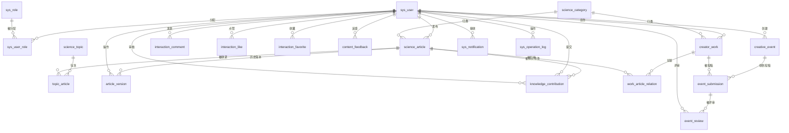

# 数据库设计

> 对应开发档案第 7 章。物理实现见 `database/schema.sql`，演示数据见 `database/seed.sql`。
> 本文档同时作为论文「数据库设计」章节的素材。

## 1. 设计原则

| 原则 | 落地方式 |
| --- | --- |
| 命名统一 | 表名小写下划线；主键统一 `id BIGINT UNSIGNED` 自增；时间统一 `DATETIME` |
| 字符集统一 | `utf8mb4 / utf8mb4_general_ci`，正文用 `LONGTEXT`，摘要用 `VARCHAR(500)` |
| 可追溯 | 需要追责的数据带 `created_at` / `updated_at`；审核类数据另带 `reviewer_id` / `reviewed_at` |
| 逻辑删除 | 只对「用户可见的业务主体」使用 `deleted`（用户、文章、专题、作品、活动）；关系表与日志表不软删 |
| 状态显式化 | 状态用 `VARCHAR(20)` 存大写英文枚举，含义集中在数据字典中说明，避免各表散落魔法值 |
| 引用完整 | 强关联（谁属于谁）用外键约束；多态关联（评论/点赞/收藏指向文章或作品）不加外键，由 Service 校验 |
| 幂等约束 | 点赞、收藏、投稿、评审、专题文章、作品文章关系均设唯一索引，从数据库层杜绝重复数据 |

## 2. 表分组（共 22 张）

| 分组 | 表 | 说明 |
| --- | --- | --- |
| 账号与权限（3） | `sys_user`、`sys_role`、`sys_user_role` | 用户、角色字典、多对多授权 |
| 知识库（4） | `science_category`、`science_topic`、`science_article`、`topic_article` | 分类、专题、正式文章、专题与文章关联 |
| 可追溯（2） | `article_version`、`knowledge_contribution` | 历史版本快照、知识补充/纠错建议 |
| 创意作品（2） | `creator_work`、`work_article_relation` | 作品本体、作品与文章关联 |
| 社区互动（4） | `interaction_comment`、`interaction_like`、`interaction_favorite`、`content_feedback` | 评论、点赞、收藏、内容反馈 |
| 主题活动（3） | `creative_event`、`event_submission`、`event_review` | 活动、投稿、评审 |
| 消息与日志（2） | `sys_notification`、`sys_operation_log` | 站内通知、重要操作日志 |
| 系统设置（2） | `sys_config`、`sys_announcement` | 平台基础配置（键值对）、系统公告 |

> 最后两张表是第二轮优化新增的，用于支持「系统基础设置」模块。
> 它们不引用任何业务表，因此不影响既有数据与接口契约。

## 3. 实体关系图

> `interaction_comment` / `interaction_like` / `interaction_favorite` / `content_feedback`
> 通过 `target_type + target_id` 多态指向文章或作品，因此不与 `science_article` / `creator_work`
> 建立物理外键，目标存在性由 Service 层校验（见第 5 节）。

## 4. 关键关系说明

1. **用户与角色是多对多**。一个用户可以同时是创作者和普通用户；管理员与超级管理员的账号由初始化脚本创建，不开放自助注册。角色判断在后端完成，前端菜单只是体验层。
2. **一篇文章可以属于多个专题**，一个专题包含多篇文章，因此需要 `topic_article` 关联表，并保留 `sort_order` 控制专题内的阅读顺序。
3. **一件作品可以关联多篇科普文章**，一篇文章也可以被多件作品引用，通过 `work_article_relation` 表达。这是「知识文章与创意作品存在明确关联」这一项目特色的数据基础。
4. **知识贡献与文章版本是两条独立的链**：贡献记录的是「读者提交了什么、谁审核、结论如何」；版本记录的是「文章曾经是什么样」。两者通过 `article_version.source_contribution_id` 连起来，实现从历史版本反查是哪条贡献导致的修改。
5. **活动评审记录关联投稿而不是直接关联作品**。因为同一件作品可以在不同活动中被评审，评审分属于具体的投稿记录。
6. **通知通过 `related_type + related_id` 指向业务对象**，便于前端从消息跳回文章、作品或活动。

## 5. 几个刻意的设计决策

### 5.1 为什么 `article_version.version_no` 表示「变更前的内容」

开发档案 5.1 规定的审核通过流程是：读取当前正式文章 → 创建历史版本快照 → 更新正式文章 → 修改贡献状态 → 写通知，全部在同一事务内完成。

因此快照保存的是**被覆盖之前的旧内容**，`version_no` 与当时文章的 `version_no` 相同；随后文章的 `version_no` 加 1。

结论：`science_article.version_no = N` 表示"当前是第 N 版"，`article_version` 中最多存在到 `N-1` 号快照，`UNIQUE(article_id, version_no)` 保证同一个版本号不会被写入两次。

演示数据中文章 3 已按此流程更新过一版：`version_no = 2`，`article_version` 中存在 `version_no = 1` 的快照，其 `source_contribution_id = 2` 指向那条被采纳的纠错建议。

### 5.2 为什么点赞/收藏用唯一索引而不是先查后插

先 `SELECT` 判断是否存在、再 `INSERT`，在并发下会漏判。正确做法是依赖 `UNIQUE(user_id, target_type, target_id)` 唯一约束，插入冲突时捕获异常并按「已点赞」处理。数据库层约束是最后一道防线，不依赖应用层自觉。

### 5.3 为什么逻辑删除只给部分表

`deleted` 只加在可能被外键引用、且删除后仍需保证历史数据可读的表上（用户、文章、专题、作品、活动）。
评论有自己的 `status`（`VISIBLE/HIDDEN/DELETED`），因为它需要「管理员隐藏」和「作者删除」两种语义，用状态表达比布尔删除更合适。
日志与通知不做软删，它们本身就是历史记录，没有删除的业务需求。

### 5.4 外键取 RESTRICT（默认）而非 CASCADE

档案第 10 章要求「删除优先软删除/下架；校验被引用资源，防止删除造成页面错误」。外键采用默认的 `RESTRICT`，物理删除被引用数据时数据库会直接拒绝，逼迫业务层走软删除或下架流程，避免出现「文章被删了但评论还挂着」的悬空引用。

## 6. 索引与约束统计

| 项目 | 数量 |
| --- | --- |
| 表 | 22 |
| 外键约束 | 31 |
| 索引（含主键与唯一索引） | 79 |

索引设计要点：

- 列表页高频筛选走组合索引：`science_article(status, published_at)`、`knowledge_contribution(status, created_at)`、`creative_event(status, start_at, end_at)`
- 多态关联查询走 `(target_type, target_id)`，评论额外带 `status`
- 通知的未读计数走 `(recipient_id, is_read, created_at)`
- 公告栏走 `(status, sort_order)`，配合 `published_at` 保证排序稳定
- 平台配置走唯一索引 `uk_config_key`，按键取值不扫表
- 标题类模糊搜索（`LIKE '%关键词%'`）无法命中 B+Tree 前缀索引，按档案要求不引入全文检索引擎，数据量在演示规模下可接受，这一点在论文「不足与展望」中说明

## 7. 相关文件

| 文件 | 内容 |
| --- | --- |
| `database/schema.sql` | 建库建表、索引、外键、字段注释 |
| `database/seed.sql` | 演示数据（6 个账号、8 篇文章、4 件作品、3 条贡献、2 个活动、5 项平台配置、3 条公告等） |
| [数据字典](数据字典.md) | 逐表逐字段说明 |
